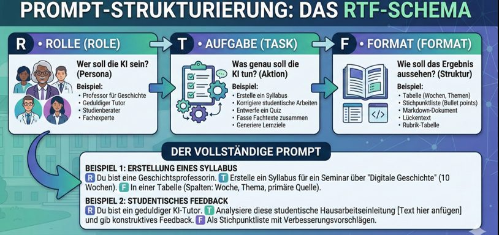

::: th-color-bar
:::

::: lernziel-box
#### Was Sie nach diesem Workshop können

- Unstrukturierte Terminangaben aus ILU oder Modulbeschreibungen automatisch in importierbare Kalenderdaten (.ics) überführen,
- umfangreiche Stoffkataloge (z. B. *Mathematisch-physikalische Grundlagen 1*) von einer KI auf logische Abhängigkeiten analysieren lassen,
- das **4D-Framework** (*Delegate*, *Describe*, *Discern*, *Diligence*) an einer praktischen Organisationsaufgabe anwenden,
- einen zweistufigen **Master-Prompt zur Semester- und Lernorganisation** aufbauen und für eigene Module nutzen.
:::

::: {.content-visible when-profile="dozent"}
::: callout-important
## Dozentenhinweis — Block 0, Tool-Vorstellung

Keine lange Theorie. Kurz auf die kostenlosen Standard-Tools (ChatGPT Free, Claude, Gemini) hinweisen und den hochschuleigenen, datenschutzkonformen Zugang () zeigen. Zeitbudget prüfen: Block 2 ist mit 14 Minuten angesetzt; für Block 0 und Block 1 bleiben damit zusammen 16 Minuten.
:::
:::

::: callout-tip
## Praxis-Hinweis vorab: So wird aus Code eine Kalenderdatei

Eine **.ics-Datei** ist ein standardisiertes Austauschformat für Termine, vergleichbar mit einem genormten Briefumschlag, den jede Kalender-App öffnen kann, ob Apple, Google oder Outlook [@rfc5545]. ChatGPT bietet die Datei oft direkt als Download an. Der  oder Claude geben stattdessen einen grauen Codeblock aus: Kopieren Sie ihn in einen einfachen Texteditor (Windows: *Editor*, Mac: *TextEdit* im Modus „Reiner Text“) und speichern Sie die Datei mit der Endung `.ics`, etwa `mathe1.ics`. Die Schritte zum Import in Ihre Kalender-App stehen unten in [Kalenderdatei importieren](#sec-import).
:::

## Block 1 — Termin- und Kalenderverwaltung

::: callout-note
## Das Problem

*„Stellt euch vor, ihr klickt euch in ILU durch eure sechs neuen Module. Überall stehen Zeiten wie ‚Montags 10:00–11:30 Uhr, Praktikum alle zwei Wochen ab November, Testat am 15.12.‘. Das alles manuell in den Handy-Kalender abzutippen dauert ewig, und ein einziger Zahlendreher sorgt dafür, dass ihr eine Pflichtabgabe verpasst.“*
:::

### Delegate — wer macht was?

| Die KI übernimmt | Sie übernehmen | Passendes Modell |
|---|---|---|
| Text oder Screenshot auslesen und in den technischen Kalender-Code (.ics-Syntax) übersetzen | den Zeitraum (Semesterstart und -ende) klar vorgeben und das Ergebnis vor dem Import kontrollieren | bei Screenshots ein multimodales Modell (ChatGPT, Claude, Gemini); für reinen Text reicht jedes Basis-Modell im  |

*Multimodal* heißt: Das Modell versteht neben Text auch Bilder.

### Describe — der Basis-Prompt (Stufe 1)

Der Prompt folgt dem **RTF-Schema**: *Role* (wer soll die KI sein?), *Task* (was soll sie tun?), *Format* (wie soll das Ergebnis aussehen?).

{fig-alt="Infografik mit den drei Bausteinen Rolle, Aufgabe und Format sowie zwei Beispielen für vollständige Prompts" width="85%"}



Kein eigener ILU-Kurs zur Hand? Dann nutzen Sie diesen Beispieltext:

```text
Mathe 1: Mo 08:15-09:45 Uhr in Raum 3.102 und Mi 10:00-11:30 Uhr
```

### ➡️ Anwendungsübung 1

Öffnen Sie einen Ihrer ILU-Kurse, lassen Sie sich die .ics-Datei erzeugen und importieren Sie sie in Ihren Kalender.

::: {.content-visible when-profile="dozent"}
::: callout-important
## Dozentenhinweis

Den Ablauf vorher in 60 Sekunden live am Beamer zeigen.
:::
:::

### Discern und Diligence — der Qualitätscheck

Prüfen Sie im Kalender selbst, bevor Sie dem Ergebnis trauen:

- Stimmt die Uhrzeit, oder hat die KI wegen einer falschen Zeitzone (UTC statt MEZ) alles um eine Stunde verschoben?
- Hat sie Wochenenden und Feiertage beachtet?
- Hat sie einen Raum erfunden? Im Beispieltext steht für den Mittwoch **kein** Raum. Ein „Raum 3.102“ am Mittwoch wäre eine Halluzination.

Zum Abgleich gibt es eine geprüfte Musterlösung für den Beispieltext: [beispiel-mathe1.ics](../material/beispiel-mathe1.ics){download="beispiel-mathe1.ics"}. Sie enthält 34 Termine von Montag, 05.10.2026, bis Mittwoch, 27.01.2027.

## Block 2 — Prüfungsvorbereitung und Klausur-Lernplanung · 14 Min

::: callout-note
## Das Problem

*„Stellt euch vor, das Semester neigt sich dem Ende zu, und in genau 10 Tagen steht die Klausur in ‚Mathematisch-physikalische Grundlagen 1‘ an. Ihr schaut auf zwei Seiten Stoffkatalog voller Fachbegriffe: Vektorprodukt, Kinematik, Skalarprodukt, Differentialrechnung, Drehbewegung. Jetzt panisch irgendwo in der Mitte anzufangen, ist tödlich, weil die Themen aufeinander aufbauen. Wie teilen wir uns diesen Berg für die letzten 10 Tage taktisch und logisch sinnvoll ein?“*
:::

### Delegate — wer macht was?

| Die KI übernimmt | Sie übernehmen | Passendes Modell |
|---|---|---|
| fachliche Abhängigkeiten zwischen den Themen erkennen (Grundlagen zuerst, Anwendungen direkt danach) und den Stoff rückwärts auf die 10 Tage verteilen, inklusive Puffertag | das realistische tägliche Zeitbudget vorgeben, den .ics-Teil aus Stufe 1 streichen, die Aufgaben an den geplanten Tagen selbst rechnen | jedes Text-Sprachmodell mit gutem logischem Verständnis (, ChatGPT, Claude) |

### Describe — das Upgrade zum Klausur-Lernplaner (Stufe 2)

Wir nehmen das Grundgerüst aus Block 1, streichen den .ics-Befehl und bauen den Prompt zu einem **taktischen Klausur-Lernplaner** um.



### Material: Themenliste zum Kopieren

Diese Liste ist ein vereinfachtes Übungsbeispiel, nicht der offizielle Stoffkatalog des Moduls. Als Datei: [stoffkatalog-mpg1.txt](../material/stoffkatalog-mpg1.txt){download="stoffkatalog-mpg1.txt"}.

```text
Mathematik
Mathe 1: Funktionen und Grenzwerte
Mathe 2: Differentialrechnung (Ableitungsregeln, Kettenregel, Kurvendiskussion)
Mathe 3: Vektoren (Darstellung, Komponenten, Betrag, Einheitsvektor)
Mathe 4: Vektoraddition und Zerlegung von Vektoren
Mathe 5: Skalarprodukt (Winkel zwischen Vektoren, Projektion)
Mathe 6: Integralrechnung (Stammfunktion, bestimmtes Integral)
Mathe 7: Vektorprodukt (Kreuzprodukt, Rechte-Hand-Regel)

Physik
Physik 1: Physikalische Größen, Einheiten und Messunsicherheit
Physik 2: Kinematik (Ort, Geschwindigkeit, Beschleunigung, Wurf)
Physik 3: Dynamik (Newtonsche Axiome, Kräfte, Reibung)
Physik 4: Arbeit, Energie und Leistung
Physik 5: Impuls und Stoß
Physik 6: Drehbewegung (Winkelgeschwindigkeit, Drehmoment, Trägheitsmoment)
```

### ➡️ Anwendungsübung 2 · 5 Min solo

Kopieren Sie den Stufe-2-Prompt zusammen mit der Themenliste in die KI, passen Sie Ihre tägliche Lernzeit an und lassen Sie sich den 10-Tage-Plan als Tabelle erzeugen.

::: callout-tip
## Für die Schnellen: Block 2 und Block 1 verbinden

Wenn der Plan gut aussieht, hängen Sie im selben Chat diesen Satz an. Die KI macht aus den Lerntagen dann Kalendertermine:


:::

### Discern — Think-Pair-Share · 3 Min

Vergleichen Sie Ihren Plan mit dem Ihres Sitznachbarn:

- Hat die KI von selbst erkannt, dass an den ersten Tagen Differential- und Vektorrechnung (Mathe 1–4) kommen müssen, bevor Kinematik (Physik 2) dran ist?
- Liegt das Vektorprodukt (Mathe 7) vor der Drehbewegung (Physik 6)? Das Drehmoment ist ein Vektorprodukt, ohne Mathe 7 bleibt Physik 6 unverständlich.
- Hat die KI Tag 1 als reinen Puffer- und Altklausur-Tag freigehalten, oder ist der Plan überladen?

### Diligence — das Fazit · 2 Min

Ein Lernplan bringt in technischen Fächern nur dann etwas, wenn der Schwerpunkt auf dem **eigenständigen Rechnen von Aufgaben** liegt, daher die 2/3-Regel im Prompt. Sich selbst zu testen und den Stoff über mehrere Tage zu verteilen, gehört zu den wirksamsten Lerntechniken; Wiederlesen und Markieren schneiden dagegen schwach ab [@dunlosky2013improving]. Wer sich in der letzten Woche auf eine logisch sortierte Reihenfolge verlässt, hat bei den Physik-Aufgaben das mathematische Werkzeug vom Vortag schon parat.

## Kalenderdatei importieren {#sec-import}

- **Google Kalender (Browser):** Zahnrad → *Einstellungen* → *Importieren & Exportieren* → Datei auswählen → Zielkalender wählen → *Importieren*.
- **Outlook (Web oder Desktop):** Im Kalender *Kalender hinzufügen* → *Aus Datei hochladen* bzw. die .ics-Datei per Doppelklick öffnen.
- **Apple Kalender (Mac):** *Ablage* → *Importieren* oder die Datei doppelklicken.
- **iPhone und Android:** Die .ics-Datei per Mail an sich selbst schicken und in der Mail-App antippen; das Handy bietet dann *Alle hinzufügen* an.

::: callout-warning
## Tipp: Erst in einen Testkalender importieren

Legen Sie in Ihrer Kalender-App einen leeren Kalender „KI-Test“ an und importieren Sie dorthin. Geht etwas schief, löschen Sie einfach den ganzen Testkalender, statt 34 falsche Termine einzeln zu entfernen. Weitere Fehlerbilder stehen im [Troubleshooting](../appendix/troubleshooting.qmd).
:::
